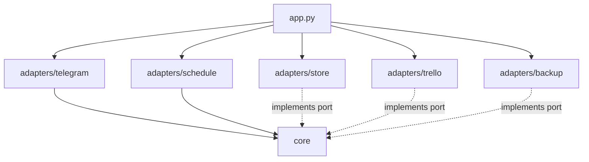
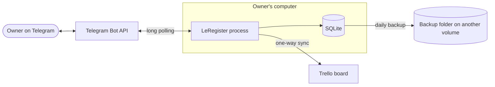
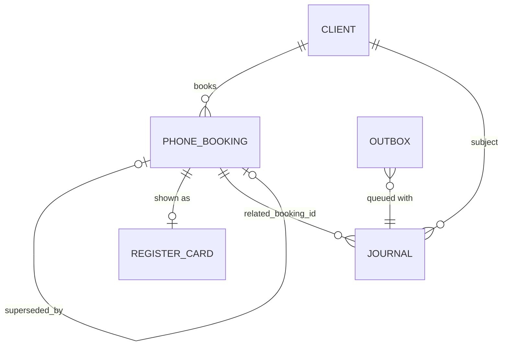

# Architecture Spine — LeRegister

## Design Paradigm

**Hexagonal (ports and adapters), with an append-only journal.** The core holds the parser, the domain rules and the use cases. It performs no I/O. Adapters sit around it and are the only code that touches the outside world.

Ports owned by the core: `Store` (a unit of work), `Clock`, `Telegram sink`, `Register sink`, `Interpreter`. Nothing else crosses the boundary.

```text
src/leregister/
  core/        # parser, domain model, rules, use cases, renderer, event schemas, ports
  adapters/
    telegram/  # receives Commands; drains the Telegram outbox
    store/     # SQLite: schema, migrations, triggers, single writer
    trello/    # drains the Register outbox
    schedule/  # 08:00 summary and daily backup triggers
    backup/    # SQLite backup and restore
    llm/       # free-text Interpreter (hosted free tier now, local model later)
  app.py       # wiring and configuration
```

## Invariants & Rules



Dependencies point inward only. Adapters never import each other.

### AD-1 — The core is pure
- **Binds:** all FRs
- **Prevents:** booking rules duplicated or changed inside Telegram, SQLite or Trello code
- **Rule:** every rule (overlap, rating, status changes, summary content, reply wording) lives in `core/`. `core` imports no adapter and no Telegram, SQLite, Trello or HTTP library, and reads time only through the `Clock` port. An `import-linter` contract in the test suite enforces this.

### AD-2 — SQLite is the single system of record; the Register is a projection
- **Binds:** FR-8, FR-12
- **Prevents:** two sources of truth, and Trello limits or outages putting data at risk
- **Rule:** all state lives in one SQLite database in WAL mode. Trello is written from it one way and never read back to decide anything, except to look up an existing card by booking id. The board must be fully rebuildable from SQLite by one `rebuild-register` command.

### AD-3 — Nothing is deleted, and storage enforces it
- **Binds:** FR-6, FR-7, FR-8
- **Prevents:** a code path, migration or bug that removes or rewrites history, and units fighting over which table holds mutable data
- **Rule:** `BEFORE` triggers abort `DELETE` on `bookings` and `journal`, and any `UPDATE` on `journal`. A `BEFORE UPDATE` trigger on `bookings` aborts unless only `status` or `superseded_by` differs between `OLD` and `NEW`, and unless the move is `active` to `changed` or `active` to `cancelled`. All other mutable data lives in side tables: `clients` (rating), `register_cards` (Trello card id per booking), `outbox`, `processed_updates`, `proposals` (pending free-text Proposals), `drafts` (one plain-words booking still being completed, per Owner chat). A booking's last-change time is derived from the journal, never stored on `bookings`. The app never uses `INSERT OR REPLACE`. Tests must fire each trigger and see it abort. Trello cards are moved between lists, never archived or deleted. Removing data requires a manual action outside the app.

### AD-4 — One Command, one transaction, then side effects
- **Binds:** FR-1, FR-4, FR-5, FR-6, FR-7, FR-9
- **Prevents:** state changed without a journal row, races in overlap checks, duplicate records when Telegram redelivers an update
- **Rule:** each Command runs as one SQLite transaction that writes its `processed_updates` row, the state change, its journal rows and its outbox rows together. All database access goes through the store adapter's single serialized writer, including scheduler jobs and outbox drainers. Nothing is sent to Telegram or Trello inside the transaction. Duplicate updates are detected by exact `update_id` match only. Edited-message updates are ignored with a reply telling the Owner to send a Change Command instead.

### AD-5 — The journal has one schema
- **Binds:** FR-5, FR-8, FR-9, FR-11, SM-5
- **Prevents:** units journaling different shapes, so history cannot be queried or audited
- **Rule:** every journal row has `id`, `at` (UTC), `event_type`, `subject_type`, `subject_id`, `related_booking_id` (nullable) and a JSON `payload`. `event_type` is a closed list defined in `core`, each with a payload schema: `booking_recorded`, `booking_changed`, `booking_cancelled`, `overlap_detected`, `rating_changed`, `command_rejected`, `summary_sent`, `backup_done`, `sync_failed`, `bot_started`, `proposal_confirmed`, `proposal_discarded`. Rejected Commands from the Owner are journaled with the reason. Messages from non-Owner accounts are not journaled.

### AD-6 — Only the Owner may act
- **Binds:** FR-3
- **Prevents:** a stranger or group chat changing data
- **Rule:** the Owner's numeric Telegram user id is set in configuration. The Telegram adapter checks it, and that the chat is private, before any parsing. All other updates are dropped without reply.

### AD-7 — The parser is deterministic and never guesses
- **Binds:** FR-1, FR-2
- **Prevents:** wrong records from heuristic date parsing, and prompt injection
- **Rule:** the parser is a pure function over a fixed grammar with a built-in French and English month table. It uses no date-guessing library and no AI model inside the parser (free text goes through AD-16, which still ends at this parser). The phone is the first token starting with `+`, and the name is every token between the Chalet number and the phone. The check-in year is the next occurrence of the start date on or after today, taken from the `Clock`. In the two-month form the check-out is the first occurrence of the end date after check-in. Chalet range and maximum stay come from configuration. Any ambiguity returns a rejection with a reason. Message text is data only and is never executed, formatted into queries, or forwarded to any tool.

### AD-8 — Dates, times and phone numbers have one form
- **Binds:** FR-1, FR-4, FR-9, FR-11
- **Prevents:** off-by-one overlaps, timezone drift, one Client stored under two phone formats
- **Rule:** dates are ISO dates, and a booking occupies the nights from check-in up to but not including check-out. Timestamps are UTC ISO-8601. "Today" and 08:00 are computed in `Asia/Beirut`. Phone numbers must start with `+` and a country code. They are validated and normalized to E.164 with `phonenumbers`, and the E.164 form is the Client key. A number without `+`, or an invalid one, is rejected. No default region exists.

### AD-9 — Overlap is derived from the post-Command state
- **Binds:** FR-4, FR-5, FR-7, FR-12
- **Prevents:** false Alerts on a Change, an Overlap stored in two places, repeated Alerts
- **Rule:** one `core` function computes Overlaps from the `active` bookings after the Command's changes are applied. Overlap is never stored. An Overlap pair is identified as (lower id, higher id). An Alert is queued once per pair that is new after the Command, and a `overlap_detected` journal row is written for it. A Change marks the old booking `changed` before the check runs, so a booking never overlaps its own predecessor.

### AD-10 — The outbox is the only way out
- **Binds:** FR-1, FR-4, FR-8, FR-11, FR-12
- **Prevents:** lost or doubled replies, a Trello outage failing a Command, units sending directly
- **Rule:** every Telegram message and every Trello change is an `outbox` row with a `destination` (`telegram` or `register`) and an optional unique `dedupe_key`. Each destination has one drainer, owned by its adapter, that sends in id order, retries with backoff, and marks a row done only after success. Delivery is at-least-once. Rows carry ids, not rendered text. Text is rendered at send time by the one `core` renderer, in English, as plain text without Markdown, split at 4096 characters. After 3 failed attempts on a `register` row the Owner is told. An unexpected error in a Command reaches the Owner as a reply and a log line, and is never silent.

### AD-11 — The Register is a pure function of the database
- **Binds:** FR-12, FR-5, FR-9
- **Prevents:** stale or duplicate cards, undecided card mapping
- **Rule:** one board named "LeRegister - Phone bookings only", one card per booking. A card sits in list `Cancelled` or `Changed` by Status, else `Overlap` if it is in a current Overlap, else `Active`. The card shows Chalet, Client name, phone, dates, Rating and last-change time. After any Command, cards are re-synced for every booking whose list or content changed, including the neighbours of a cleared Overlap and every booking of a Client whose Rating changed. The booking id sits in the card description. Before creating a card the drainer looks one up by booking id. After restoring a backup, `rebuild-register` is run.

### AD-12 — The Morning Summary is queued once per day
- **Binds:** FR-11
- **Prevents:** a silently missed summary, or two summaries for one date
- **Rule:** the scheduler queues the summary through the outbox with `dedupe_key` `summary:<date>`. On startup, if today's key is missing and it is before 12:00, the Bot queues it marked late. A crash between sending and marking done can rarely send it twice. That is accepted, and a missed summary is not.

### AD-13 — A Rating changes only with a journal row
- **Binds:** FR-9, FR-10
- **Prevents:** a Rating that disagrees with its history, and two owners of Client data
- **Rule:** a Client row is created only by a `New` Command. The booking keeps the name as given, and the Client name is set at first booking and then informational. The Rating lives on the Client row, starts at 5, moves by 1 per report and stays within 1-5. Each change is written in the same transaction as its `rating_changed` journal row.

### AD-14 — Long polling on the Owner's computer
- **Binds:** FR-1, FR-3, FR-11
- **Prevents:** needing a public address, open ports or a hosted service
- **Rule:** the Bot receives updates by long polling and opens no inbound port. Telegram holds unreceived updates for at most 24 hours, so Commands sent during a shorter outage are applied in order on restart. After a longer outage some are lost, so on startup the Bot journals `bot_started` and tells the Owner how long it was offline and to resend anything sent in that time.

### AD-15 — Backups live somewhere else
- **Binds:** FR-8
- **Prevents:** losing the database and its only backup together
- **Rule:** the daily backup uses SQLite's online backup API, keeps the last 7, and writes to a configured directory on a different volume or synced folder than the live database. The Bot warns the Owner at startup if they share a volume. A restore procedure is documented and tested. After a restore the Owner is told to resend Commands sent since the backup.

### AD-16 — The Interpreter only proposes
- **Binds:** FR-13, FR-2, FR-3
- **Prevents:** an LLM guess reaching the records, prompt injection acting on data, and a free-tier outage blocking Commands
- **Rule:** a message that matches no strict Command goes to the `Interpreter` port (adapter `adapters/llm/`). The model receives the Owner's message with any phone number replaced by a placeholder (the phone is found and kept locally and never sent), the fixed instructions and the Command schema. On a follow-up it also receives the guest name, chalet and dates already understood from the Owner's own earlier message and the kind of question just asked. It never receives stored bookings or Clients. Its answer lists each part of a booking as a value or null; relative or unclear dates are null and never guessed. Its output is JSON with a fixed schema, validated in `core`, rendered as a strict Command and re-parsed by AD-7, which stays the only authority on validity. A booking that is still incomplete is kept as a draft in `drafts` (one per Owner chat, expiring 10 minutes after its last change, at most 3 questions) and the Bot asks for the first missing part; the next message fills or corrects it, a different guest name or a complete booking replaces it, and `stop`, `forget it`, `never mind` or a strict `New` drops it. A valid Proposal is saved in `proposals` and shown with Confirm and Cancel. Only on Confirm, from the Owner's private chat (AD-6), does it run the same use case as a typed Command (AD-4). Proposals expire after 10 minutes, a second Confirm does nothing, and each outcome is journaled (`proposal_confirmed`, `proposal_discarded`). The model has no tools and no database access. Timeouts, errors and rate limits reply with the strict format, with no retry loop and no transaction held during the call. The provider is chosen by configuration, and only the adapter changes: Groq's hosted free tier now (default model `openai/gpt-oss-20b`, with Zero Data Retention switched on by the Owner in the Groq console), a local model such as Ollama later. Logs carry ids, not message text.

## Consistency Conventions

| Concern | Convention |
| --- | --- |
| Naming | Python `snake_case`. Domain terms from the PRD glossary used verbatim: `phone_booking`, `client`, `overlap`, `journal`. |
| Data and formats | IDs are integer primary keys. Dates ISO `YYYY-MM-DD`. Timestamps UTC ISO-8601. Phones E.164. Statuses are exactly `active`, `changed`, `cancelled`. |
| Errors | The parser and core return typed results (`ok` or `rejected(reason)`), not exceptions, for expected failures. Every rejection reaches the Owner as a reply. |
| State and cross-cutting | State changes only through core use cases (AD-4). Schema changes are numbered SQL migrations applied at startup and tracked in `schema_version`. Configuration and secrets (Telegram token, Trello key and token, Owner id, chalet count, maximum stay, paths) come from environment variables or a `.env` kept outside the repository. Development and tests use their own database path and a separate Telegram bot token. |
| Personal data | Logs carry ids, never guest names or phone numbers. Guest data appears only in the database, the backup folder and the private Trello board. Formal data protection is phase 3. |

## Stack

| Name | Version |
| --- | --- |
| Python | 3.11.9 (installed) |
| python-telegram-bot, with `job-queue` extra | 22.8 |
| APScheduler (via the extra) | 3.11.3 |
| phonenumbers | 9.0.42 |
| tzdata (timezone data, required on Windows) | latest at install |
| httpx (via python-telegram-bot, also used for Trello) | as resolved, `>=0.27,<0.29` |
| import-linter (dev) | 2.15 |
| SQLite (standard library) | 3.45.1 (whatever the Python bundles) |
| uv (environment and dependencies) | 0.13.7 |
| LLM provider client (over httpx) | hosted free tier, provider to be chosen at build time; verify current free-tier limits and data-use terms |
| Trello (free plan, REST API) | current. Free-plan limits come from secondary sources: check trello.com/pricing |

## Structural Seed





Operating environment: the process runs on the Owner's computer as a background service that starts at login or boot. Only the Telegram and Trello endpoints are reached, outbound over HTTPS. A down Bot is noticed by the missing Morning Summary, as the PRD accepts.

## Capability → Architecture Map

| Capability / Area | Lives in | Governed by |
| --- | --- | --- |
| FR-1, FR-2 Record and reject | `core` parser and use case, `adapters/telegram` | AD-4, AD-5, AD-7, AD-8 |
| FR-3 Owner only | `adapters/telegram` | AD-6 |
| FR-4, FR-5 Overlap and Journal | `core` overlap function, `adapters/store` | AD-3, AD-4, AD-5, AD-9 |
| FR-6, FR-7 Cancel and change | `core` use cases, `adapters/store` | AD-3, AD-4, AD-9 |
| FR-8 Safe and current | `adapters/store`, `adapters/backup` | AD-2, AD-3, AD-10, AD-15 |
| FR-9, FR-10 Rating | `core`, `adapters/store` | AD-13 |
| FR-11 Morning Summary | `core` summary, `adapters/schedule` | AD-8, AD-10, AD-12 |
| FR-12 Register | `adapters/trello` | AD-2, AD-10, AD-11 |
| FR-13 Free-text input | `core` Interpreter port and proposal use case, `adapters/llm`, `adapters/telegram` (buttons) | AD-3, AD-4, AD-6, AD-7, AD-16 |

## Deferred

- **Always-on reliability** of the Owner's computer (sleep settings, updates) and the choice of service wrapper on Windows: decide at first deployment. AD-12 and AD-14 already cover downtime.
- **External heartbeat** (a way to learn the Bot is down other than the missing summary): the PRD accepts the missing summary, so this waits for the Owner to ask.
- **Trello alternatives** (self-hosted boards): only if the free plan ever blocks the Register. The Register sink port makes this a swap.
- **Local model for the Interpreter** (e.g. Ollama) replacing the hosted free tier: a swap of `adapters/llm/` only (AD-16). Do it when the Owner's computer can run one, or if the hosted terms prove unacceptable.
- **Guest-data retention and data protection:** phase 3, per the PRD.
- **Test strategy and CI:** left to the first stories, apart from the trigger and import-linter tests above.
